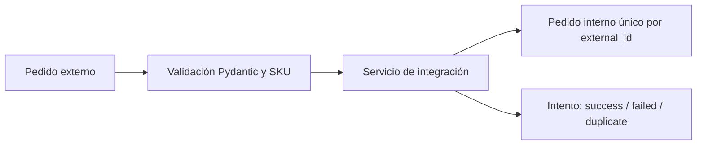

# External Orders API + Order Agent

API que recibe pedidos de un sistema externo, valida sus productos y registra el resultado de la integración. Si llega dos veces el mismo pedido, devuelve el existente para evitar duplicados.

**Python · FastAPI · SQLAlchemy · Pydantic · SQLite / PostgreSQL · pytest**

[Implementación y decisiones técnicas](docs/implementation.md) · [Portfolio](https://felipeheredia.vercel.app)

## Nuevo: recepción asistida de pedidos

Primer incremento del agente: texto → borrador validado → revisión humana → aprobación → creación idempotente. Guarda estados y eventos en la base; permite corregir datos faltantes y reintentar sin duplicar pedidos. Incluye un adaptador de extracción con Ollama y una demo JSON sin IA ni claves.

**[Guía del agente, demo y arquitectura](docs/order-agent.md)**

```sh
# Con la API encendida y ORDER_AGENT_PROVIDER=json (predeterminado):
python scripts/order_agent_demo.py
# Aprobar explícitamente el ejemplo y crear el pedido:
python scripts/order_agent_demo.py --approve
```

Es un flujo asistido con pasos controlados por código; el modelo no ejecuta acciones autónomas. La guía describe sus límites y los siguientes incrementos.

## Problema y solución

Una integración necesita más que un endpoint: debe reconocer reintentos, rechazar productos desconocidos y permitir saber por qué falló una sincronización. Este proyecto implementa ese recorrido con una API pequeña y pruebas aisladas.



## Probar localmente

```sh
git clone https://github.com/FelipeH99/external-orders-api.git
cd external-orders-api
python3 -m venv .venv
source .venv/bin/activate
pip install -r requirements.txt
python -m app.init_db
uvicorn app.main:app --reload
```

En Windows, activá el entorno con `.venv\Scripts\activate`. El ejemplo usa SQLite; no requiere Docker. Abrí **http://127.0.0.1:8000/docs** para explorar la API.

```sh
curl -X POST http://127.0.0.1:8000/orders/external \
  -H 'Content-Type: application/json' \
  -d '{"external_id":"DEMO-001","cliente":"Demo","fecha":"2026-11-19T12:00:00","lineas":[{"sku":"SKU-001","cantidad":2,"precio":"10.50"}]}'
```

Repetí la solicitud con el mismo `external_id`: debe devolver el pedido existente y registrar el intento duplicado. Consultá `/sync-attempts` para ver la trazabilidad.

## Comprobación

```sh
pytest
```

Las pruebas usan SQLite en memoria, separada de tu base local. La guía técnica explica cómo probar [PostgreSQL con Docker](docs/implementation.md#usar-postgresql-con-docker).

## Organización

- `app/main.py`: endpoints.
- `app/schemas.py`: contratos de entrada y salida.
- `app/services.py`: validación de negocio y procesamiento.
- `app/models.py`: pedidos, productos e intentos.
- `tests/`: pruebas de API y reglas de integración.

## Alcance

Demostración de integración, sin autenticación ni paginación. La inicialización usa `create_all`; migraciones, autorización, observabilidad y endurecimiento de concurrencia son pasos pendientes para un entorno de producción. No se conecta a un ERP real.
