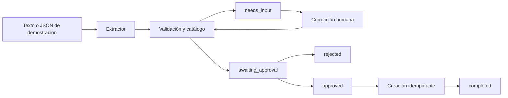

# Agente de pedidos — primer incremento

Flujo asistido de recepción de pedidos sobre la API existente. Un extractor propone un borrador; Python valida los datos y el catálogo. Una persona revisa la propuesta y una llamada explícita aprueba esa versión antes de ejecutar la creación.

**Estado:** MVP de backend. No es un agente autónomo: la secuencia de pasos está definida en código y el modelo no elige herramientas ni puede crear pedidos. No incluye autenticación, correo, ERP real ni interfaz visual propia. Swagger permite probar el recorrido.



## Ejecutar sin modelo ni claves

Desde la raíz, usando el entorno virtual y dependencias del README:

```sh
ORDER_AGENT_PROVIDER=json uvicorn app.main:app --reload
```

En otra terminal:

```sh
python scripts/order_agent_demo.py
```

Muestra el borrador y su total, sin crear un pedido. El modo `json` acepta un documento estructurado como texto: **no interpreta lenguaje natural y no usa IA**.

Para aprobar explícitamente los datos de ejemplo, crear el pedido y comprobar un reintento:

```sh
python scripts/order_agent_demo.py --approve
```

También podés usar el ejemplo en Swagger (`http://127.0.0.1:8000/docs`) o por HTTP:

```sh
curl -X POST http://127.0.0.1:8000/agent/runs \
  -H 'Content-Type: application/json' -d @examples/agent-intake.json
```

## Interpretar texto con Ollama

Usá un modelo local ya instalado que soporte salidas estructuradas. No se descarga ningún modelo al iniciar la API. Indicá su nombre exacto, según `ollama list`:

```sh
ORDER_AGENT_PROVIDER=ollama OLLAMA_MODEL=llama3.2:latest \
  uvicorn app.main:app --reload
```

Ollama debe estar disponible en `http://localhost:11434`; `OLLAMA_BASE_URL` permite configurar otro servidor de confianza. El texto y el catálogo se envían a ese servidor. No hay fallback silencioso a la demo si falla.

```sh
python scripts/order_agent_demo.py --text \
  'Pedido para Acme SA, fecha 2026-11-19T10:00:00Z: 2 unidades de SKU-001 a 10.50 cada una.'
```

La implementación usa [salidas estructuradas de Ollama](https://docs.ollama.com/capabilities/structured-outputs), valida la respuesta con Pydantic y consulta el catálogo real. Los datos faltantes quedan como `null`. Una comprobación adicional elimina precios que no aparecen numéricamente en el texto original; no garantiza que cada número esté asociado a la línea correcta. Por ahora, los precios escritos en palabras o con separadores de miles requieren revisión manual. El modelo puede equivocarse o inventar valores incluso con estas instrucciones: compará siempre `source_text` con `draft` antes de aprobar. Las instrucciones del prompt no constituyen una garantía contra inyección; el bloqueo de ejecución es una regla del servidor.

## Contrato HTTP

| Método y ruta | Función |
| --- | --- |
| `POST /agent/runs` | Recibe `request_id` y `text`; extrae, valida y persiste un borrador |
| `GET /agent/runs/{id}` | Recupera borrador, origen, proveedor, estado, versión, total y pedido asociado |
| `PUT /agent/runs/{id}/draft` | Reemplaza el borrador con `{ "version": 1, "draft": {...} }` |
| `POST /agent/runs/{id}/decision` | Decide con `{ "version": 1, "decision": "approve" }` o `reject` |
| `POST /agent/runs/{id}/execute` | Crea únicamente un borrador aprobado; permite reintentos |
| `GET /agent/runs/{id}/events` | Historial de creación, revisiones, decisión y ejecución |

Repetir `request_id` con el mismo texto devuelve el mismo borrador. Reutilizarlo con otro texto devuelve `409`. Una revisión incrementa `version`: aprobar una versión vieja también devuelve `409`. Los borradores aprobados y rechazados son inmutables; creá una solicitud nueva para modificarlos.

Faltan datos o hay SKU desconocidos → `needs_input`; la respuesta detalla `issues`. Corregí el borrador completo, no una aprobación incompleta. Valores inválidos (cantidades negativas o fraccionarias, precios con más de dos decimales) se rechazan. El total se calcula con `Decimal`; no incluye impuestos, descuentos, stock ni moneda. Los precios son propuestos y revisados, no obtenidos de una tarifa. Las fechas se normalizan a UTC; una fecha sin zona se interpreta como UTC.

## Persistencia y recuperación

`agent_runs` y `agent_events` se crean al arrancar junto a las tablas existentes. El borrador aprobado queda persistido. La creación usa un `external_id` estable: `agent:{run_id}`. Si el proceso se interrumpe después de crear el pedido pero antes de marcar el flujo como completado, se puede volver a llamar a `/execute`: reutiliza el pedido existente.

Un fallo del extractor no crea un borrador ni un pedido: se puede repetir la solicitud. Un error de validación de catálogo durante la ejecución mantiene el estado `approved` y agrega un evento. Los errores de infraestructura pueden devolver `500`; no hay worker ni reintento automático todavía. Los eventos no son un registro firmado ni tienen identidad de usuario.

## Docker

```sh
docker compose -f compose.agent.yml up --build
python scripts/order_agent_demo.py --url http://127.0.0.1:8001 --approve
```

El puerto se publica solo en localhost y la base SQLite queda en un volumen. La demo predeterminada no necesita Ollama. En Docker, `localhost` apunta al contenedor: para un modelo en el host usá `OLLAMA_BASE_URL=http://host.docker.internal:11434`, con un servicio accesible desde Docker. No es necesario exponer Ollama para probar el modo JSON.

## Verificación

```sh
pytest -q
```

Pruebas aisladas: aprobación obligatoria, corrección/versionado, rechazo, idempotencia, datos incompletos, SKU desconocido, valores inválidos, recuperación después del commit del pedido, fallos del proveedor y contrato HTTP de Ollama simulado. Las pruebas del adaptador no miden la calidad semántica del modelo ni sustituyen evaluaciones con textos reales.

## Próximos incrementos

1. Autenticación y permisos: identificar quién revisa y quién ejecuta, con auditoría de identidad. **No desplegar esta API abierta:** cualquiera con acceso puede invocar la aprobación, y `/orders/external` sigue disponible para integración directa.
2. Evaluaciones con ejemplos etiquetados: campos esperados, solicitudes ambiguas, prompt injection y omisiones; medir exactitud, latencia y tokens por modelo.
3. Bandeja de revisión con comparación del texto original y el borrador, edición y decisión.
4. Migraciones, worker, reintentos con backoff y pruebas concurrentes en PostgreSQL.
5. Herramientas de consulta a clientes y tarifas del ERP en un entorno de prueba; autonomía acotada solo cuando aporte valor.

### Comprobaciones del primer incremento

- 39 pruebas automatizadas locales pasando, sin consumir un modelo remoto.
- Demo HTTP real: aprobación, creación y segundo intento con el mismo ID de pedido.
- Prueba manual con `llama3.2:latest` local: extracción correcta de un pedido con SKU, fecha, cantidad y precio explícitos. En una solicitud incompleta el modelo inventó inicialmente un precio; se agregó una comprobación contra el texto y una prueba de regresión. También se observaron errores de productos/cantidades: esta prueba no acredita exactitud general del modelo.
- Configuración de Compose validada. Aunque el daemon Docker local devolvió un error, [GitHub Actions construyó la imagen y ejecutó la demo dentro del contenedor](https://github.com/FelipeH99/external-orders-api/actions/runs/44587611234), incluyendo aprobación, creación y reintento idempotente.
